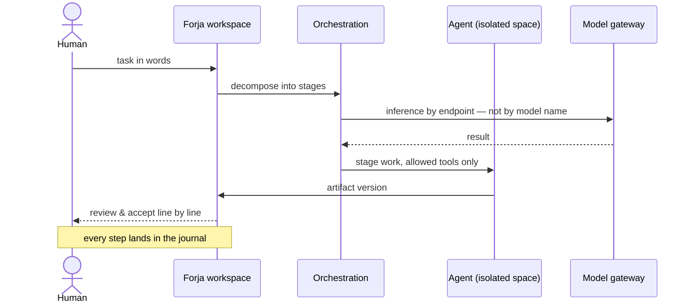
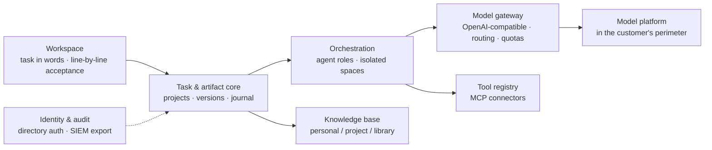
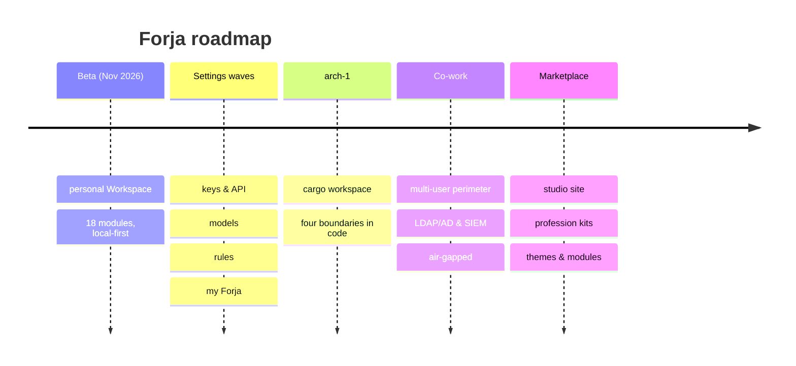

# Forja — an agentic workspace for real work

**English** | [Русский](ru/README.md)

> Task in words. Agent works in an isolated space. Human accepts the result line by line.
> The last mile of agentic work — document work in a perimeter you control.

**Concept showcase — documents only.** The application lives in a private repository.
This repo shows *why* the product exists, *how* it is designed, and *where it differs from the market*.

Desktop app: **Tauri 2 (Rust core) + React + TypeScript + SQLite**. 18 built-in modules, local database, no cloud dependency.

---

## Why

AI coding agents proved the model: delegate a task, get a result. The industry shipped parallel agents ([Cursor](https://cursor.com), [Conductor](https://conductor.build), [GitHub Copilot](https://github.com/features/copilot)), self-hosted control centers ([OpenHands](https://github.com/All-Hands-AI/OpenHands)), and on-prem agent platforms. All of it speaks to developers — and almost all of it speaks to code.

Nobody ships the last mile: **a workspace for the business user who does not open a terminal**, where the unit of work is a *document with versions* and the unit of trust is an *explicit acceptance act*.

| The market | What's missing |
|---|---|
| Cloud file-agents (Copilot Cowork, Claude Cowork-style) — agent in their cloud, no on-prem | work inside the customer's perimeter |
| Self-hosted agent platforms (OpenHands, agent runtimes) — built for developers, terminal-first | a place for people who work with documents and spreadsheets, not code |
| Agent platforms in a perimeter — model and RAG without the user-facing workspace | the workspace itself: tasks, artifacts, acceptance |
| Acceptance everywhere is a button on a chat message or an action confirmation | versioned artifacts, line-by-line acceptance, a journal that forms an audit trail |

## The loop

The product's subject is the whole chain, not a feature inside it:

```
task in words → decomposition into stages → isolated space
   → artifact with versions → explicit acceptance → journal
```



Intermediate results are visible at every stage — the human refines the task *before* the work completes, not after.

## Four properties

| Property | Implementation |
|---|---|
| **Isolated spaces** | every task runs in its own space: data, history and versions never bleed into another context |
| **Allowed tools only** | the agent reaches files, databases and internal systems exclusively through registry-listed connections; every call is logged |
| **Stage decomposition** | hours-long work is split into stages with visible intermediate results |
| **Artifact + acceptance** | the outcome is a document or data extract in an agreed format, with version history; nothing is "done" until the responsible human confirms it |

## Model-agnostic by design

The system addresses the model **by endpoint, not by name**. Swapping a model provider — on-prem platform, local inference, or a cloud gateway — is configuration, not code:



Bring your own model, bring your own keys — the gateway speaks the OpenAI-compatible API, quotas are tracked, provider details never leak into application subsystems.

## Two profiles, one product

| | **Forja Workspace** | **Forja Co-work** |
|---|---|---|
| Who | individuals leading several projects through CLI agents (OpenCode, Qwen Code, Codex, Gemini CLI) | teams and departments working with documents and extracts — no terminal required |
| Where | local-first desktop app, data in plain folders and SQLite | on-prem: air-gapped operation, directory (LDAP/AD) auth, journal export to SIEM |
| Trust model | your machine, your keys | isolated spaces, inherited permissions (an agent sees only what the delegating employee sees), 100%-journal |
| Status (Nov 2026) | working, in beta | designed — see [docs/02-architecture.md](docs/02-architecture.md) §4 |

## Status & roadmap



Details, including the explicit "what we will NOT do": [docs/03-roadmap.md](docs/03-roadmap.md).

## Documents

| Document | Language | Content |
|---|---|---|
| [docs/01-product-line.md](docs/01-product-line.md) | EN | Problem, the loop, market differences, audience, principles, monetization |
| [docs/02-architecture.md](docs/02-architecture.md) | EN | Principles, four boundaries, eight subsystems, non-functional requirements, stack decisions |
| [docs/03-roadmap.md](docs/03-roadmap.md) | EN | Waves, corporate deployment methodology, non-goals |

Russian versions: [ru/README.md](ru/README.md) · [ru/docs/](ru/docs/)

## About the author

**VibeArchitect** — project lead & business architect (15 years in transformation and IT projects), building agentic workspaces for real teams.

- GitHub: [github.com/khsergey-afk](https://github.com/khsergey-afk)
- Telegram: [@KhSergey](https://t.me/KhSergey)
- Site: [ai-po-delu.ru](https://ai-po-delu.ru)

---

*Concept documents © 2026. Shared for portfolio purposes — read and cite with attribution.*
