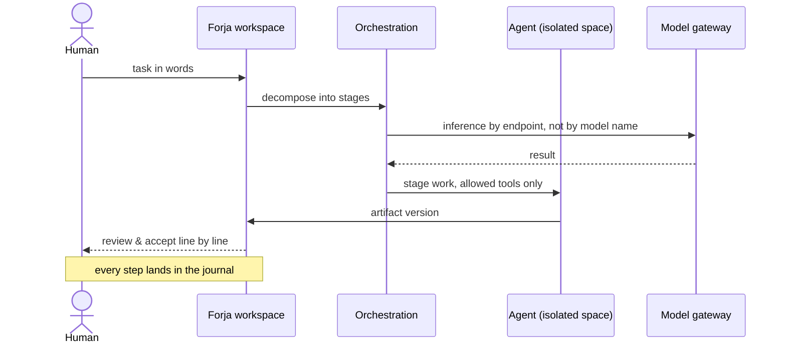

# Forja: product & positioning

**English** | [Русский](../ru/docs/01-product-line.md)

A public concept document of Forja. Edition date: 2026-11-22.
Architecture — [02-architecture.md](02-architecture.md), roadmap — [03-roadmap.md](03-roadmap.md).

## 1. What Forja is

**Forja** is a workspace where humans and AI agents work together: the task is stated in words,
the agent does the work inside an isolated space of the project, the result comes back as a
document with versions, and the human accepts it explicitly — line by line.

One product, two profiles:

- **Forja Workspace** — a personal workplace (desktop, local-first): projects, tasks, files,
  documents and CLI-agent sessions (Claude Code, OpenCode, Qwen Code, Codex, Gemini CLI) in one
  application. Works locally, no cloud.
- **Forja Co-work** — the corporate edition: a multi-user system inside the customer's closed
  perimeter — isolated spaces, roles and the organization's directory, a model gateway to the
  customer's platform, a journal of every step with export for audit. Runs without internet.

## 2. The problem

**Agent work lives where the work is not.** CLI agents live in a terminal, one session at a
time, for people who open terminals. The rest of the office does not:

- tasks arrive by email or verbally; the performer assembles source data from files, letters
  and people by hand;
- processing data extracts and cross-checking happens manually in spreadsheets — hours each time;
- approval happens as tracked changes in chat threads: the final version cannot be reassembled
  later, and edit authors are invisible;
- agent output is accepted in a terminal diff — there is no acceptance workflow;
- project knowledge (rules, briefs, decisions, logs) is smeared across files, and the agent
  rediscovers it every session.

Agent platforms cover the model, the knowledge base and the agent runtime — but not the human's
workplace. Without this last mile, agentic pilots remain demonstrations.

## 3. The work loop

The subject of the solution is the whole chain, not a set of features:

```
task in words → decomposition into stages → isolated space
   → artifact with versions → explicit acceptance → journal
```



The intermediate result of each stage is visible to the human: the task is refined *before*
the work completes, not after.

## 4. Four properties of the system

| Property | Implementation |
|---|---|
| Isolated spaces | every task runs in its own space: its data, history and versions never cross into other contexts |
| Allowed tools | the agent reaches files, databases and internal systems only through connections listed in the registry and allowed by policy; every call is logged |
| Stage decomposition | hours-long work is split into stages; intermediate results are visible, the task is refined before completion |
| Artifact & acceptance | the outcome is a document or a data extract in an agreed format with version history; the result is not considered accepted until the responsible human confirms it explicitly |

## 5. How this differs from the market

A summary of open materials from leading products, November 2026:

| # | Difference | The market | Forja |
|---|---|---|---|
| 1 | The whole chain «task → decomposition → versioned artifact → acceptance → journal» | pieces: iterations in cloud file-agents, action pause in agent platforms, agent states in frameworks | the whole chain is the subject of the solution |
| 2 | Three visibility levels for data | one array filtered by permissions | hard separation of personal / project / library; moving between levels is an explicit action; publishing requires a check and a version |
| 3 | A workplace for non-IT users in a closed perimeter | self-hosting exists in developer tools; business products are cloud-only | the mile inside the perimeter: no terminal, no external SaaS, runs without internet |
| 4 | Model replaceability | vendor cloud lock-in | the system addresses the model by endpoint (OpenAI-compatible gateway); swapping a model is configuration, not code |
| 5 | Acceptance as an act + inherited permissions | action confirmation (everywhere) and permissions separate from isolation | an acceptance act in the journal; an agent in a sandbox sees only what the delegating employee sees |

## 6. Who it is for

- **The first user** — a specialist working with documents and extracts who never opens a
  terminal. The base persona is the business analyst: states the task in words, accepts the
  result.
- **Personal profile (Workspace)** — people leading several projects through CLI agents:
  developers, automators, analysts.
- **Corporate profile (Co-work)** — a team and a department: multi-user mode, roles (project
  owner / member / observer), accounts from the organization's directory (LDAP/AD), a journal
  exported to SIEM.

## 7. Product principles

1. **Data belongs to the human.** Projects are folders, the database is open SQLite, profile
   export is built in. Personal data is invisible and unindexed by default; it reaches a project
   only by an explicit action; it reaches the library only via publication with a check and a
   version.
2. **Work before decoration.** Short sentences; no «revolution» or «ecosystem» talk; one joke
   per screen, no more.
3. **No numbers without measurement.** Neither public nor deal materials contain indicators that
   were not measured on real work.
4. **Explicit actions.** Moving data between levels, editing the agent environment, publishing
   to the library — separate conscious human actions, not background magic.

## 8. Monetization

- Free entry: the personal Workspace, no limits on projects.
- Paid — what teams and professions need: the corporate edition with delivery into the
  customer's perimeter (license + implementation work), profession kits (prompts, templates,
  checklists), themes and modules sold one-off.
- Models are never resold: the system connects to the customer's platform or a chosen provider
  with the customer's own keys.
- Server-side features ship only after demand is confirmed by talking to people —
  see [03-roadmap.md](03-roadmap.md), «Boundaries».
