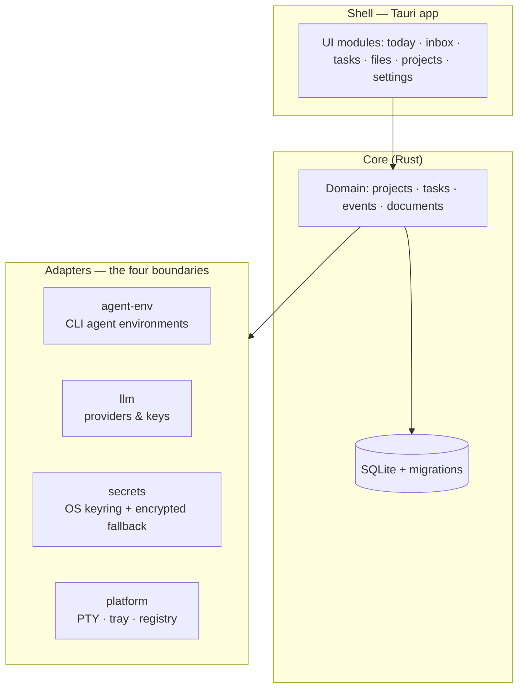
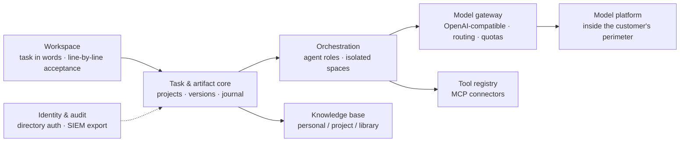

# Forja architecture: boundaries, subsystems, scaling

**English** | [Русский](../ru/docs/02-architecture.md)

A public concept document of Forja. Edition date: 2026-11-22. Sources — the internal architecture
concept of 2026-11-08 and the corporate requirements specification of 2026-11-18, reworked for
publication: no code listings, no personal paths, no context of specific negotiations.

## 1. Summary

Forja is a working monolith: one SQLite database, one module registry (18 modules), a Rust core
with a single list of invoke commands. For the beta of the personal Workspace this is enough.
What blocks scaling is not the monolith as such, but **four couplings**: direct reads of the CLI
agent environment from many modules, data the application does not own, features living outside
the application, and OS services called head-on. The solution is to draw **four boundaries**
step by step, without stopping development. The corporate edition (Co-work) is designed from the
start as **eight subsystems** with one key principle: *the system addresses the model by endpoint,
not by model name* — swapping the model does not change application subsystems.

## 2. Principles (modeled on Obsidian)

| Principle | Obsidian | Forja |
|---|---|---|
| Data belongs to the human | vault is a plain folder of markdown files | projects are the human's folders; the database is open SQLite; profile export is built in |
| Core + modules | core plugins toggle in settings | Forja sections are built-in modules; toggling off keeps the code |
| The module brings its settings | a plugin registers its tab | a settings section is declared next to the module; the settings screen only collects them |
| Services are not the core | Sync/Publish are paid clients above the core | sync and team work form a separate layer; without it Forja is complete |
| Privacy by default | local, no telemetry; Sync is E2E | everything local; in the corporate perimeter — encryption and air-gapped operation |
| One core, all platforms | desktop + mobile, one core | Tauri 2: desktop and mobile from one codebase; the agent part is desktop-native |

## 3. Personal Workspace: four boundaries

- **A UI module** = a view + a panel + a settings section + keybindings + its own tables.
  A new section of the app is one module outside the core.
- **The core** = the domain (projects, tasks, events, documents) + SQLite + migrations.
  Invoke commands are the future API: grouped by domain, no duplicate paths to one operation.
- **agent-env** is the only module that knows the paths of CLI-agent environments; outward it
  exposes domain operations («read rules», «list agents», «transcripts», «subscription login»).
  A new CLI agent is one adapter; the core does not change.
- **llm** — providers and keys behind one registry; a new provider is a registry entry.
- **secrets** — the OS keyring first, an encrypted file in the profile as fallback (portability).
- **platform** — OS specifics behind one interface; changing the OS swaps the layer, the domain
  survives.

## 4. Corporate perimeter (Co-work): eight subsystems

| Subsystem | Contents |
|---|---|
| A-1 Workplace | task stated in words, decomposition, statuses, line-by-line acceptance of the result |
| A-2 Task & artifact core | projects, artifact versions with visible diffs of edits, acceptance as a journal act, a task board with human and agent assignees |
| A-3 Orchestration & sandboxes | isolated execution spaces, agent roles, pause/resume, limits |
| A-4 Model gateway | OpenAI-compatible client; routing, failover, consumption accounting; **addressing the model by endpoint** |
| A-5 Tool registry & connectors | MCP (stdio/HTTP), OAuth 2.x with PKCE; files, databases, internal APIs — only through the registry |
| A-6 Knowledge base & search | three visibility levels (personal / project / library), permission-aware search, answers with links and a perimeter marker |
| A-7 Identity, permissions, audit | login through the organization's LDAP/AD; an agent's permissions inherit from the employee; a journal of every step, exported to SIEM |
| A-8 Admin & accounting | settings, policies, quotas, reporting |

Interaction order: task → allowed tool call → model request → result → acceptance → journal.
Data never leaves the perimeter; external models and SaaS connectors are disabled by default.

**Non-functional requirements of the corporate edition:**

| Requirement | Meaning |
|---|---|
| Closed perimeter | the whole functionality works without an external network; external models are disabled |
| Explicit acceptance | a result is not considered accepted without confirmation by the responsible human; the delegating and reviewing roles are separate |
| Traceability | a journal of tasks, tool calls and acceptances — 100% of actions, exportable for audit |
| Multi-user mode | isolated spaces, roles, accounts from the organization's directory |
| Model replaceability | moving to another platform model or self-hosted inference — via gateway configuration |

## 5. Settings as a system

1. The module declares its settings section; the settings screen only collects and renders.
2. Five settings groups (App / Work / Connections / Data / About) — they do not grow.
3. Reset lives in the section; «reset everything» only in «About».
4. Section toggles move to settings when truly detachable modules appear.

## 6. Backend evolution

| Stage | What | When |
|---|---|---|
| 0. Now | Tauri monolith, commands in one list, everything local | beta — untouched |
| 1. Core seam | cargo workspace: core (domain+data+commands), adapters, app; commands become thin; the core is tested without UI | after beta |
| 2. Server services | project sync across machines, mobile access, team work; the client ships as a module, encryption on the client | after demand is confirmed |
| 3. Marketplace | a showcase of kits/assistants as a separate site; the app is a catalog client | with monetization |

API strategy: the invoke commands are the Forja API; at stage 2 the same operations open
outward under the same contract (JSON-RPC over sync).

## 7. Stack: what was chosen and why

| Decision | What | Rationale |
|---|---|---|
| Keep | **Tauri 2 + Rust + React + TypeScript + SQLite (FTS5)** | Tauri 2 — small binaries, system webview, desktop and mobile from one codebase; the stack already carries the product |
| Integrations | **MCP (Model Context Protocol)** — a registry of connectors to files, databases and internal APIs | a connector is described as data; a new source is an entry, not a code branch |
| Database | SQLite for the beta; **PostgreSQL compatibility designed in from day one** | data access sits behind one repository layer; migrations stay in the common SQL subset; the stage-2 server runs the same schema on Postgres |
| Add (stage 1) | cargo workspace, platform feature flags | separating core and adapters without a rewrite |
| Not taking | Electron (weight/memory), a server DB before server services, a REST layer «for the future», rewriting the UI on another framework | premature; YAGNI |

## 8. Extensibility: rules introduced up front

Cheap now, expensive later — introduced with stage 1:

| Rule | What it buys |
|---|---|
| Tables of new domains/modules carry a prefix (`nsi_*`, `design_*`); core and module tables never mix | a module can be cut out or built separately without dissecting the database |
| Reference data (NSI) is a separate contour: versioned dictionaries (styles, templates, model maps), import/export, delivery as kits | dictionaries are edited by the delivery, not by user tasks |
| Integrations are declarations: a connector is described as data, code only in adapters | a new source is an entry, not a code branch |
| Module registry: id, version, contents, status | always visible what owns what |
| Build profile — a filter over the registry | adaptive builds: free — the core, professions — kits and modules |

**Themes as the first product, kits as the mechanism.** A theme is a special case of a kit:
style files and a palette, installed in one action. Add-ons (themes, methodology kits, modules)
go through one mechanism: registry + showcase + «installed / newer available».

## 9. What we will NOT do (boundaries of the concept)

- No rewriting the monolith for beauty: boundaries are drawn where it already hurts.
- No server before team work is confirmed by interviews and pilots.
- No section toggles in settings until truly detachable modules exist.
- No changes to the project's service contour (`wiki\`, `raw\`, rules) — it is the contract with
  the user and the agents.
- No touching the legal frame of keys: the user's keys, no proxying.
