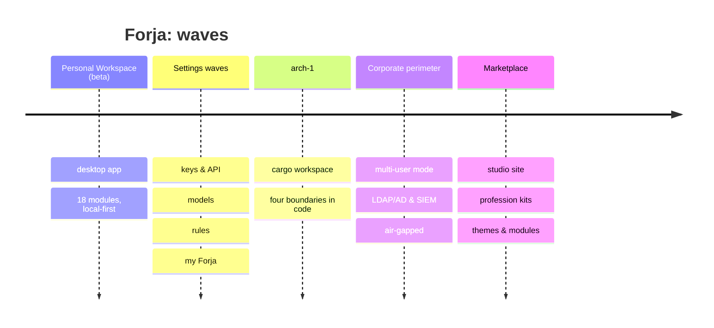

# Forja roadmap

**English** | [Русский](../ru/docs/03-roadmap.md)

A public concept document of Forja. Edition date: 2026-11-22. The order and content of waves is
fixed; internal dates are not published.

## Development vectors

## 1. Personal Workspace — in progress

| Wave | What |
|---|---|
| w1–w4 | «Keys & API», «Models», the «Rules» section, «My Forja», settings cleanup |
| w5 | Clean machine: a missing agent environment degrades with words («environment not set up — Connect»), not errors |
| w6 | Legacy names: migrating contracts and hints to the current name |
| w7 | Status and usage scripts move inside the application, no external dependencies |
| d-1 | Document storage model: «Documents» = accepted only; paths in the database are relative; a single write point |

## 2. arch-1 — the architecture wave (after beta)

- cargo workspace: core (domain + data + commands) / adapters / app;
- `agent-env` — the only module that knows CLI-agent environment paths;
- an encrypted-file secret store beside the OS keyring;
- settings sections declared by modules;
- the extensibility rules from [02-architecture.md](02-architecture.md) §8: table prefixes,
  the reference-data contour, integration declarations, the module registry, build profiles.

## 3. The corporate perimeter (Forja Co-work)

The target system is described in [02-architecture.md](02-architecture.md) §4. A typical
implementation order — as a delivery methodology:

| Stage | What happens | Exit criterion |
|---|---|---|
| Survey | load profile, stack, knowledge sources, baseline metrics; the threat model — with the customer's security team | target values fixed; architecture approved — without this the pilot does not start |
| First development cycle | model-gateway prototype → orchestrator and spaces → artifact pipeline and audit | 2–3 real scenarios run end-to-end; air-gapped operation verified |
| Department pilot | workplaces, quotas, integrations, notifications; tests including offline operation | target metrics measured and met or re-approved; acceptance act, journal export |
| Production operation | support: rules and agent kits — by the system vendor, the platform — under the platform's SLA | operation accepted by the customer |

Model replaceability is verified by the gateway prototype in the first third of the first
cycle — an integration surprise never reaches the pilot.

## 4. Showcase & kits (with monetization)

- the studio site: product line, pricing, documentation;
- Kits — profession packs: prompts, templates, checklists, rules;
- themes and modules as add-ons through one mechanism: registry + showcase + «installed /
  newer available»;
- the marketplace is a separate site; the app is a catalog client.

## 5. Boundaries: what will not happen, and why

1. **No server before demand is proven.** Subscriptions and the team edition are confirmed by
   interviews (Mom Test) and pilots, not by code: the server is built for a confirmed need.
2. **No cloud dependency.** Forja is complete without the cloud; the human's data stays local
   and portable. The corporate edition runs without internet.
3. **No rewriting for beauty.** Boundaries are drawn where it already hurts; the beta monolith
   is not touched for architectural purity.
4. **No promises without measurement.** Public materials contain no numbers that were not
   measured: effects are computed after the survey, on measured values.
5. **No rev-share, no sources.** Platform integration happens over APIs only; exclusive rights
   to the code stay with the author.
