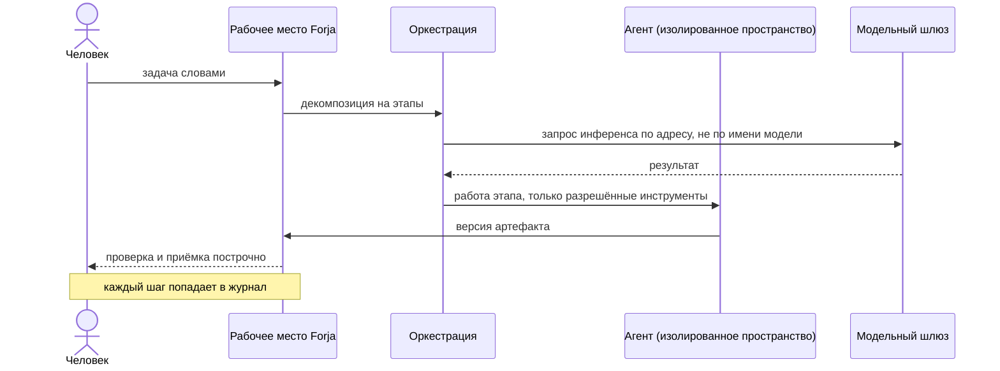
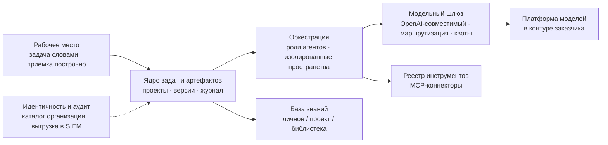
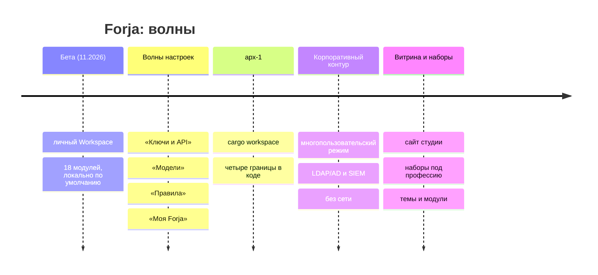

# Forja — агентное рабочее место для реальной работы

**[English](../README.md) | Русский**

> Задача — словами. Агент работает в изолированном пространстве. Человек принимает результат
> построчно.
> Последняя миля агентной работы — работа с документами в контуре, который вы контролируете.

**Витрина концепции — только документы.** Приложение живёт в приватном репозитории.
Этот репозиторий показывает, *почему* продукт существует, *как* он спроектирован и *чем
отличается от рынка*.

Десктоп-приложение: **Tauri 2 (ядро на Rust) + React + TypeScript + SQLite**. 18 встроенных
модулей, локальная база, без облачной зависимости.

---

## Почему

ИИ-агенты для кода доказали модель: поручи задачу — получи результат. Индустрия выпустила
параллельных агентов ([Cursor](https://cursor.com), [Conductor](https://conductor.build),
[GitHub Copilot](https://github.com/features/copilot)), self-hosted центры управления
([OpenHands](https://github.com/All-Hands-AI/OpenHands)) и on-prem агентные платформы. Всё это
говорит с разработчиками — и почти всё про код.

Никто не доводит до конца последнюю милю: **рабочее место для бизнес-пользователя, который не
открывает терминал**, где единица работы — *документ с версиями*, а единица доверия — *явный
акт приёмки*.

| Рынок | Чего не хватает |
|---|---|
| Облачные файловые агенты (Copilot Cowork, Claude Cowork-класс) — агент в их облаке, on-prem нет | работа внутри контура заказчика |
| Self-hosted агентные платформы (OpenHands, рантаймы агентов) — для разработчиков, терминал-first | место для тех, кто работает с документами и выгрузками, а не с кодом |
| Агентные платформы в контуре — модель и RAG без рабочего места пользователя | само рабочее место: задачи, артефакты, приёмка |
| Приёмка везде — кнопка на сообщении чата или подтверждение действия | версии артефактов, построчная приёмка, журнал, образующий аудиторский след |

## Петля работы

Предмет продукта — вся цепочка целиком, а не фича внутри неё:

```
задача словами → декомпозиция на этапы → изолированное пространство
   → артефакт с версиями → явная приёмка → журнал
```



Промежуточный результат каждого этапа виден человеку — постановка уточняется *до* завершения
работы, а не после.

## Четыре признака

| Признак | Реализация |
|---|---|
| **Изолированные пространства** | каждая задача ведётся в своём пространстве: данные, история и версии не пересекаются с чужими контекстами |
| **Только разрешённые инструменты** | агент обращается к файлам, базам и внутренним системам исключительно через подключения из реестра, разрешённые политикой; каждый вызов фиксируется |
| **Декомпозиция на этапы** | работа на часы делится на этапы с видимыми промежуточными результатами |
| **Артефакт + приёмка** | итог — документ или выгрузка в согласованном формате с историей версий; ничего не «готово», пока ответственный человек не подтвердил явно |

## Model-agnostic by design

Система обращается к модели **по адресу, а не по имени**. Смена провайдера модели — on-prem
платформа, локальный инференс или облачный шлюз — это настройка, а не код:



Своя модель, свои ключи: шлюз говорит на OpenAI-совместимом API, расход учитывается, детали
провайдера не протекают в прикладные подсистемы.

## Два профиля, один продукт

| | **Forja Workspace** | **Forja Co-work** |
|---|---|---|
| Кому | тем, кто ведёт несколько проектов через CLI-агентов (OpenCode, Qwen Code, Codex, Gemini CLI) | командам и подразделениям, работающим с документами и выгрузками — терминал не нужен |
| Где | local-first десктоп, данные в обычных папках и SQLite | on-prem: работа без интернета, вход через каталог организации (LDAP/AD), выгрузка журнала в SIEM |
| Модель доверия | ваша машина, ваши ключи | изолированные пространства, наследование прав (агент видит только то, что видно поручившему), журнал 100 % |
| Статус (11.2026) | работает, в бете | спроектирован — [docs/02-architecture.md](docs/02-architecture.md) §4 |

## Статус и roadmap



Подробно, включая явное «чего мы НЕ делаем»: [docs/03-roadmap.md](docs/03-roadmap.md).

## Документы

Русские документы — в этой папке; английские — в корне репозитория.

| Документ (RU) | Документ (EN) | Содержание |
|---|---|---|
| [docs/01-product-line.md](docs/01-product-line.md) | [../docs/01-product-line.md](../docs/01-product-line.md) | Проблема, петля, отличия от рынка, аудитория, принципы, монетизация |
| [docs/02-architecture.md](docs/02-architecture.md) | [../docs/02-architecture.md](../docs/02-architecture.md) | Принципы, четыре границы, восемь подсистем, НФТ, решения по стеку |
| [docs/03-roadmap.md](docs/03-roadmap.md) | [../docs/03-roadmap.md](../docs/03-roadmap.md) | Волны, методология внедрения Co-work, границы |

## Об авторе

**VibeArchitect** — руководитель проектов и бизнес-архитектор (15 лет в трансформационных и
ИТ-проектах), строит агентные рабочие места для реальных команд.

- GitHub: [github.com/khsergey-afk](https://github.com/khsergey-afk)
- Telegram: [@KhSergey](https://t.me/KhSergey)
- Сайт: [ai-po-delu.ru](https://ai-po-delu.ru)

---

*Концептуальные документы © 2026. Публикуются как портфолио — читать и цитировать с атрибуцией.*
