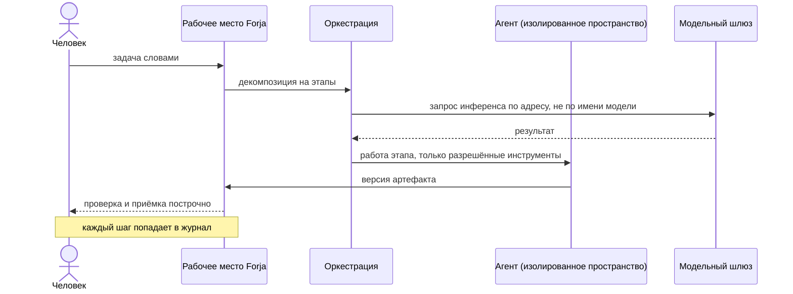

# Forja: продукт и позиционирование

**[English](../../docs/01-product-line.md) | Русский**

Документ публичной витрины концепции Forja. Дата редакции: 22.11.2026.
Архитектура — [02-architecture.md](02-architecture.md), дорожная карта — [03-roadmap.md](03-roadmap.md).

## 1. Что такое Forja

**Forja** — рабочее место совместной работы человека и ИИ-агентов: задача ставится словами,
агент делает работу в изолированном пространстве проекта, результат возвращается документом
с версиями, и человек принимает его явно — построчно.

Два профиля одного продукта:

- **Forja Workspace** — личное рабочее место (desktop, local-first): проекты, задачи, файлы,
  документы и сеансы CLI-агентов (OpenCode, Qwen Code, Codex, Gemini CLI) в одном
  приложении. Работает локально, без облака.
- **Forja Co-work** — корпоративная версия: многопользовательская система в закрытом контуре
  заказчика — изолированные пространства, роли и каталог организации, модельный шлюз к платформе
  заказчика, журнал каждого шага с выгрузкой для аудита. Работа без интернета.

## 2. Проблема

**Работа с агентами живёт не там, где работа.** CLI-агенты живут в терминале, по одному сеансу,
для того, кто терминал открывает. Остальная часть офиса — нет:

- постановка задачи уходит письмом или устно; исполнитель сам собирает исходные данные по файлам,
  письмам и людям;
- обработка выгрузок и сверка — руками в электронных таблицах, часы на каждую;
- согласование — правки в переписке: финальную версию потом не собрать, авторов правок не видно;
- результат агента принимается в терминальном диффе — сценария приёмки нет;
- знание проекта (правила, брифы, решения, журналы) размазано по файлам, и агент ищет его заново
  каждый сеанс.

Агентные платформы закрывают модель, базу знаний и рантайм — но не рабочее место человека.
Без этой «последней мили» агентные пилоты остаются демонстрациями.

## 3. Петля работы

Предмет решения — цельная цепочка, а не набор фич:

```
задача словами → декомпозиция на этапы → изолированное пространство
   → артефакт с версиями → явная приёмка → журнал
```



Промежуточный результат каждого этапа виден человеку: постановка уточняется до завершения
работы, а не после неё.

## 4. Четыре признака системы

| Признак | Реализация |
|---|---|
| Изолированные пространства | каждая задача ведётся в отдельном пространстве: её данные, история и версии не пересекаются с чужими контекстами |
| Разрешённые инструменты | агент обращается к файлам, базам и внутренним системам только через подключения из реестра, разрешённые политикой; каждый вызов фиксируется |
| Декомпозиция длительных задач | работа на часы делится на этапы; промежуточный результат виден, постановка уточняется до завершения |
| Артефакт и приёмка | итог — документ или выгрузка в согласованном формате с историей версий; результат не считается принятым, пока ответственный не подтвердил явно |

## 5. Чем это отличается от рынка

Свод по открытым материалам ведущих продуктов, ноябрь 2026:

| # | Отличие | У рынка | У Forja |
|---|---|---|---|
| 1 | Цепочка «задача → декомпозиция → артефакт с версиями → приёмка → журнал» целиком | куски: итерации у файловых агентов облачных сервисов, приостановка действий у агентных платформ, состояния агентов у фреймворков | вся цепочка — предмет решения |
| 2 | Три уровня видимости данных | единый массив с фильтрацией по правам | жёсткое разделение «личное / проект / библиотека»; перенос между уровнями — только явным действием, публикация с проверкой и версией |
| 3 | Рабочее место для не-ИТ-пользователей в закрытом контуре | self-host умеют инструменты для разработчиков; бизнес-продукты — облачные | миля в контуре: без терминала, без внешних SaaS, работа без интернета |
| 4 | Заменяемость модели | привязка к облаку вендора | система обращается к модели по адресу (OpenAI-совместимый шлюз); смена модели — настройкой, без правки кода |
| 5 | Приёмка как акт + наследование прав | подтверждение действия (у всех) и права отдельно от изоляции | акт приёмки версии в журнале; агент в песочнице видит только то, что видно поручившему сотруднику |

## 6. Для кого

- **Первый пользователь** — специалист, работающий с документами и выгрузками и не открывающий
  терминал. Базовый персонаж — бизнес-аналитик: ставит задачу словами, принимает результат.
- **Личный профиль (Workspace)** — тот, кто ведёт несколько проектов через CLI-агентов:
  разработчики, автоматизаторы, аналитики.
- **Корпоративный профиль (Co-work)** — команда и подразделение: многопользовательский режим,
  роли (владелец проекта / участник / наблюдатель), учётные записи из каталога организации
  (LDAP/AD), журнал с выгрузкой в SIEM.

## 7. Принципы продукта

1. **Данные принадлежат человеку.** Проекты — папки, база — открытый SQLite, экспорт профиля —
   из приложения. Личное по умолчанию невидимо и не индексируется; в проект — только явно
   положенное; в библиотеку — только через публикацию с проверкой.
2. **Дело раньше украшений.** Короткие фразы, никакой «революции» и «экосистем»; одна шутка
   на экран — не больше.
3. **Никаких цифр без замера.** Публичные и переговорные материалы не содержат показателей,
   которые не измерены на реальной работе.
4. **Явные действия.** Перенос данных между контурами, правка среды агента, публикация в
   библиотеку — отдельные осознанные действия человека, не фоновая магия.

## 8. Монетизация

- Вход бесплатный: личный Workspace без ограничений по проектам.
- Платное — то, что нужно команде и профессии: корпоративная версия и поставка в контур
  (лицензия + работы по внедрению), наборы под профессию (промпты, шаблоны, проверки),
  темы и модули разово.
- Модели не перепродаются: система подключается к платформе заказчика или к выбранному
  провайдеру по его ключам.
- Серверные функции появляются только после подтверждения спроса разговорами с людьми —
  см. [03-roadmap.md](03-roadmap.md), «Границы».
