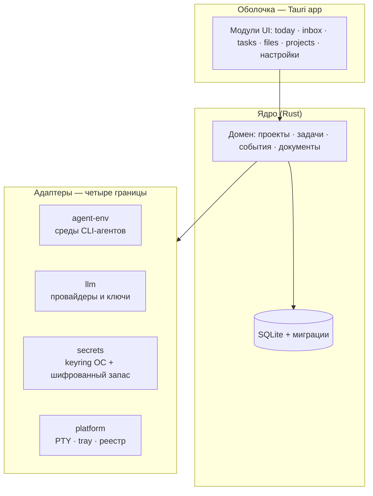
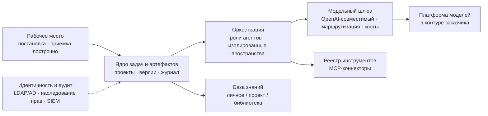

# Архитектура Forja: границы, подсистемы, масштабирование

**[English](../../docs/02-architecture.md) | Русский**

Документ публичной витрины концепции Forja. Дата редакции: 22.11.2026. Источники — внутренняя
архитектурная концепция от 08.11.2026 и корпоративное ТЗ от 18.11.2026, переработанные для
публикации: без листингов кода, личных путей и контекста конкретных переговоров.

## 1. Вывод

Forja — работающий монолит: одна база SQLite, один реестр разделов (18 модулей), ядро на Rust
с единым списком invoke-команд. Для беты личного Workspace этого достаточно. Мешает
масштабированию не монолит как таковой, а **четыре завязки**: прямые чтения среды CLI-агента
из многих модулей, данные, которыми приложение не владеет, функции, живущие вне приложения,
и вызовы сервисов ОС в лоб. Решение — провести **четыре границы** поэтапно, без остановки
разработки. Корпоративная версия (Co-work) проектируется сразу как **восемь подсистем** с
одним ключевым принципом: *система обращается к модели по адресу, а не к конкретной модели
в коде* — замена модели не меняет прикладные подсистемы.

## 2. Принципы (образец — Obsidian)

| Принцип | У Obsidian | У Forja |
|---|---|---|
| Данные принадлежат человеку | vault — обычная папка markdown | проекты — папки человека; база — открытый SQLite; экспорт профиля из приложения |
| Ядро + модули | core-плагины включаются тумблером | разделы Forja — встроенные модули; выключение — тумблером, код остаётся |
| Настройки приносит модуль | плагин регистрирует свою вкладку | секция настроек описывается рядом с модулем, экран настроек только собирает |
| Сервисы — не ядро | Sync/Publish — платные клиенты поверх ядра | синхронизация и командная работа — отдельный слой; без него Forja полноценна |
| Приватность по умолчанию | локально, без телеметрии; Sync — E2E | всё локально; в корпоративном контуре — шифрование и работа без интернета |
| Одно ядро на платформы | десктоп + мобильный, ядро одно | Tauri 2: десктоп и мобильные из одной кодовой базы; агентная часть — десктоп-природа |

## 3. Личный Workspace: четыре границы

- **Модуль UI** = вид + панель + секция настроек + клавиши + свои таблицы. Новый раздел — один
  модуль снаружи от ядра.
- **Ядро** = домен (проекты, задачи, события, документы) + SQLite + миграции. Invoke-команды —
  будущее API: группируются по доменам, «двоенных» путей к одной операции нет.
- **agent-env** — единственный, кто знает пути среды CLI-агентов; наружу — доменные операции
  («прочитать правила», «список агентов», «транскрипты», «вход по подписке»). Новый CLI-агент —
  один адаптер, ядро не меняется.
- **llm** — провайдеры и ключи за одним реестром; новый провайдер — запись реестра.
- **secrets** — keyring ОС основной, шифрованный файл в профиле — запас (переносимость).
- **platform** — ОС-специфика за интерфейсом; смена ОС — замена слоя, домен цел.

## 4. Корпоративный контур (Co-work): восемь подсистем

| Подсистема | Состав |
|---|---|
| А-1 Рабочее место | постановка задачи словами, декомпозиция, статусы, построчная приёмка результата |
| А-2 Ядро задач и артефактов | проекты, версии артефактов с различием правок, приёмка как акт в журнале, доска задач со статусами людей и агентов |
| А-3 Оркестрация и песочницы | изолированные пространства исполнения, роли агентов, пауза/возобновление, лимиты |
| А-4 Модельный шлюз | клиент, совместимый с OpenAI; маршрутизация, резервирование, учёт расхода; **обращение к модели по адресу** |
| А-5 Реестр инструментов и коннекторы | MCP (stdio/HTTP), OAuth 2.x с PKCE; файлы, базы, внутренние API — только через реестр |
| А-6 База знаний и поиск | три уровня видимости (личное / проект / библиотека), поиск с правами, ответы со ссылками и признаком контура |
| А-7 Идентичность, права, аудит | вход через LDAP/AD организации; права агента наследуются от сотрудника; журнал каждого шага с выгрузкой в SIEM |
| А-8 Админка и учёт | настройки, политики, квоты, отчётность |

Порядок взаимодействия: постановка → вызов разрешённого инструмента → запрос модели →
результат → приёмка → журнал. Данные не покидают контур; внешние модели и SaaS отключены
по умолчанию.

**НФТ корпоративной версии:**

| Требование | Что значит |
|---|---|
| Закрытый контур | весь функционал работает без внешней сети; внешние модели отключаются |
| Явная приёмка | результат не считается принятым без подтверждения ответственного; поручающий и проверяющий разделены |
| Прослеживаемость | журнал поручений, вызовов инструментов и приёмок — 100 % действий, выгрузка для аудита |
| Многопользовательский режим | изолированные пространства, роли, учётные записи из каталога организации |
| Заменяемость модели | переход на другую модель платформы или собственный инференс — настройкой шлюза |

## 5. Настройки как система

1. Секцию настроек объявляет модуль; экран настроек только собирает и рисует.
2. Групп настроек пять (Приложение / Работа / Подключения / Данные / О программе) — не растут.
3. Сброс — у секции; «сброс всего» — только в «О программе».
4. Тумблеры разделов выводятся в настройки, когда появятся действительно отключаемые модули.

## 6. Эволюция бэкенда

| Этап | Что | Когда |
|---|---|---|
| 0. Сейчас | Tauri-монолит, команды одним списком, всё локально | бета — не трогаем |
| 1. Разъём ядра | cargo workspace: ядро (домен+данные+команды), адаптеры, приложение; команды тонкие, ядро тестируется без UI | после беты |
| 2. Серверные сервисы | синхронизация проектов между машинами, мобильный доступ, командная работа; клиент встроен как модуль, шифрование на клиенте | по подтверждению спроса |
| 3. Магазин | витрина наборов/помощников — отдельный сайт; приложение — клиент каталога | с монетизацией |

API-стратегия: invoke-команды — это API Forja; на этапе 2 те же операции открываются наружу тем
же контрактом (JSON-RPC поверх синхронизации).

## 7. Стек: что выбрано и почему

| Решение | Что | Основание |
|---|---|---|
| Оставляем | **Tauri 2 + Rust + React + TypeScript + SQLite (FTS5)** | Tauri 2 — малые бинарники, системный webview, десктоп и мобильные из одной кодовой базы; стек уже несёт продукт |
| Интеграции | **MCP (Model Context Protocol)** — реестр коннекторов к файлам, базам и внутренним API | коннектор описан данными; новый источник — запись, не ветка кода |
| СУБД | SQLite — база беты; **совместимость с PostgreSQL закладывается сразу** | доступ к данным — за одним слоем репозиториев; миграции — в общем подмножестве SQL; сервер этапа 2 поднимает ту же схему на Postgres |
| Добавляем (этап 1) | cargo workspace, feature-флаги платформы | разделение ядра и адаптеров без переписывания |
| Не берём | Electron (вес/память), серверная СУБД до серверных сервисов, отдельный REST-слой «на будущее», переписывание UI на другой фреймворк | преждевременно; YAGNI |

## 8. Расширяемость: правила, которые вводятся заранее

Дёшево сейчас, дорого потом — вводятся с этапом 1:

| Правило | Что даёт |
|---|---|
| Таблицы новых доменов/модулей — с префиксом (`nsi_*`, `design_*`); таблицы ядра и модулей не смешиваются | модуль вырезается или собирается отдельно, не разбирая базу |
| НСИ — отдельный контур: версионированные справочники (стили, шаблоны, карты моделей), импорт/экспорт, поставка наборами | справочники правит поставка, а не задачи пользователя |
| Интеграции — декларации: коннектор описан данными, код — только адаптеры | новый источник — запись, не ветка кода |
| Реестр модулей: id, версия, состав, статус | всегда видно, что чем владеет |
| Сборочный профиль — фильтр по реестру | адаптивные сборки: бесплатно — ядро, профессиям — наборы и модули |

**Темы — первый товар, наборы — механизм.** Тема — частный случай набора: файлы стилей и
палитра, установка одним действием. Add-ons (темы, наборы методологии, модули) идут одним
механизмом: реестр + витрина + «подключён / есть новее».

## 9. Что НЕ делаем (границы концепции)

- Не переписываем монолит ради красоты: границы вводятся там, где уже болит.
- Не строим сервер, пока командная работа не подтверждена интервью и пилотами.
- Не выносим тумблеры разделов в настройки до появления действительно отключаемых модулей.
- Не меняем служебный контур проекта (`wiki\`, `raw\`, правила) — это контракт с пользователем
  и агентами.
- Не трогаем юридическую рамку ключей: ключи пользователя, без прокси.
