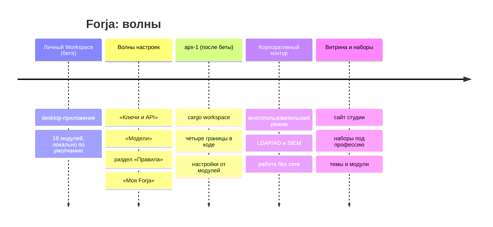

# Дорожная карта Forja

**[English](../../docs/03-roadmap.md) | Русский**

Документ публичной витрины концепции Forja. Дата редакции: 22.11.2026. Порядок и содержание
волн фиксированы; внутренние даты не публикуются.

## Векторы развития

## 1. Личный Workspace — идёт сейчас

| Волна | Что |
|---|---|
| в1–в4 | «Ключи и API», «Модели», раздел «Правила», «Моя Forja», чистка настроек |
| в5 | Чистая машина: отсутствие среды агента не ломает экраны — деградация словами («среда ещё не настроена — Подключить»), а не ошибками |
| в6 | Наследие имён: миграция контрактов и подсказок на актуальное имя |
| в7 | Скрипты статуса и расхода — внутрь приложения, без внешних зависимостей |
| д-1 | Модель хранения документов: «Документы» = только акцептованные; пути в базе относительные; единая точка записи |

## 2. арх-1 — архитектурная волна (после беты)

- cargo workspace: ядро (домен + данные + команды) / адаптеры / приложение;
- `agent-env` — единственный модуль, знающий пути сред CLI-агентов;
- запасное хранилище секретов (шифрованный файл в профиле) рядом с keyring ОС;
- секции настроек объявляются модулями;
- правила расширяемости из [02-architecture.md](02-architecture.md) §8: префиксы таблиц,
  контур НСИ, декларации интеграций, реестр модулей, сборочные профили.

## 3. Корпоративный контур (Forja Co-work)

Целевая система описана в [02-architecture.md](02-architecture.md) §4 (восемь подсистем).
Типовой порядок внедрения — как методология поставки:

| Этап | Что происходит | Критерий выхода |
|---|---|---|
| Обследование | профиль нагрузки, стек, источники знаний, базовые значения метрик; модель угроз — с ИБ заказчика | целевые значения зафиксированы; архитектура согласована — без этого пилот не начинается |
| Первый цикл разработки | прототип модельного шлюза → оркестратор и пространства → конвейер артефактов и аудит | 2–3 реальных сценария проходят сквозно; работа без сети проверена |
| Пилот подразделения | рабочие места, квоты, интеграции, уведомления; испытания включая работу без внешней сети | целевые метрики замерены и достигнуты или переутверждены; акт ввода, выгрузка журналов |
| Промышленная эксплуатация | сопровождение: правила и наборы агентов — у поставщика системы, платформа — по SLA платформы | эксплуатация принята заказчиком |

Замена модели проверяется прототипом шлюза в первой трети первого цикла — интеграционный
сюрприз не доходит до пилота.

## 4. Витрина и наборы (с монетизацией)

- сайт студии: линейка, тарифы, документация;
- Kits — наборы под профессию: промпты, шаблоны, проверки, правила;
- темы и модули как add-ons одним механизмом: реестр + витрина + «подключён / есть новее»;
- магазин — отдельный сайт, приложение — клиент каталога.

## 5. Границы: чего не будет и почему

1. **Сервер до проверки спроса.** Подписки и командная версия подтверждаются интервью
   (Mom Test) и пилотами, не кодом: сервер строится под подтверждённую потребность.
2. **Облачная зависимость.** Forja полноценна без облака; данные человека остаются локальными
   и переносимыми. Корпоративная версия работает без интернета.
3. **Переписывание ради красоты.** Границы проводятся там, где уже болит; монолит беты не
   трогается ради архитектурной чистоты.
4. **Обещания без замера.** Публичные материалы не содержат цифр, которых не мерили:
   эффекты считаются после обследования, на измеренных значениях.
5. **Ревенд и исходники.** Интеграция с платформами — только по API; исключительные права
   на код остаются у автора.
